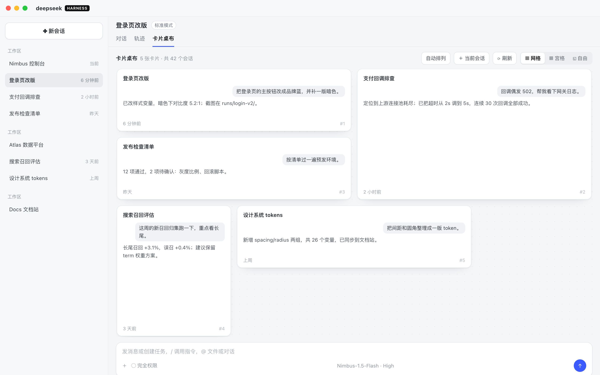
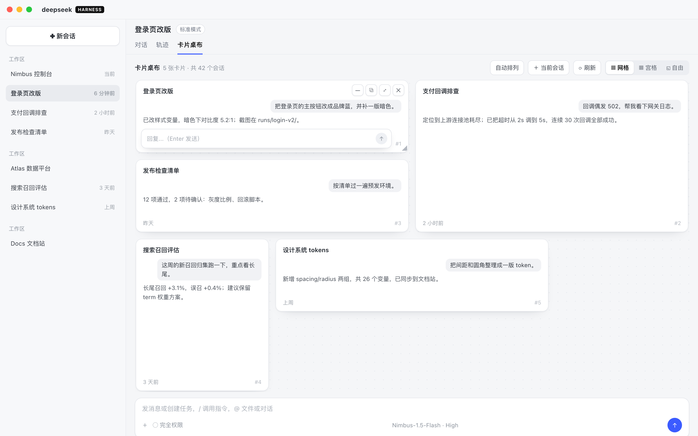

# dsh-session-cards

把 DeepSeek Harness（DSH）的会话做成**卡片桌布**：在会话详情画布上铺开一桌卡片，
拖动、缩放、最小化、最大化，也能把任意一张卡片弹出成**原生独立窗口**。

- 版本：**0.4.3** · 要求 DSH **0.2.1-rc.2+** · License MIT
- 已在 macOS + DSH NEXT Desktop（0.2.2）与 `dsh web`（0.2.1-rc.2）上实测



<p align="center"><sub>网格布局：卡片按跨度占位，可拖、可拖边缘缩放</sub></p>

## 目录

- [功能](#功能)
- [安装](#安装)
- [使用](#使用)
- [数据与隐私](#数据与隐私)
- [兼容与降级](#兼容与降级)
- [已知限制](#已知限制)
- [开发](#开发)
- [版本与发布](#版本与发布)

## 功能

**三种布局**

| 布局 | 行为 |
| --- | --- |
| 网格 | 卡片占 1–4 × 1–4 格；拖到空位就落位，拖到已占格则交换；拖边缘/角连续缩放，松手吸附到格 |
| 宫格 | 均分铺满：≤9 张 3×3，10–12 张 3×4；窄窗（<720px）退 2 列 |
| 自由 | 绝对定位，卡片可任意移动、叠放；拖四边/四角缩放（左/上边缘向外生长） |

**卡片内容**

- 真实会话记录：用户气泡、助手正文（渲染粗体/行内代码），工具调用行只在**最大化**时显示
- 标题、状态色点、工作区、相对时间；对话条数随卡片尺寸变化
- 已过滤 DSH 注入的上下文块（runtime context、技能目录、压缩摘要等），不会把注入文本当对话展示

**卡片内发消息**

- 默认只显示最后一行；鼠标移入卡片才浮出输入条（`Enter` 发送、`Shift+Enter` 换行、中文输入法选词不误发）
- 走插件 host 路由调用宿主的 `sessionController.prompt`，**不切换当前会话**
- 发送成功后清空草稿并刷新该卡片的对话



**卡片操作**

| 按钮 | 作用 |
| --- | --- |
| `−` | 最小化到画布底部 dock，点击还原 |
| `⧉` | 弹出为原生独立窗口 |
| `⤢` / `⤡` | 最大化铺满画布 / 还原（最大化时 `Esc` 也可退出） |
| `✕` | 从桌布移除（不删除会话） |

**原生浮窗**（细节见下）

- 自建 Electron 管家进程，只通过公开 `webServer`/`connection` 与插件通信，不碰 desktop 私有 API
- 原生标题栏，可拖动、可缩放；默认 520×420，多开按 +28px 级联
- 记住每个窗口的位置和尺寸；拖回主窗口自动收回；同会话去重；最多 8 个窗口
- 默认**不置顶**，需要时点浮窗里的「📌 置顶」

**主题**：light / dark / system 跟随宿主；输入条、按钮、卡片文字都给明暗两套色值。

## 安装

### 桌面端 / dsh web（GitHub）

```sh
dsh plugin --profile desktop add github:tom143tc/dsh-session-card
# 或
dsh plugin --profile web add github:tom143tc/dsh-session-card
```

安装后**完全退出**并重启 DSH NEXT（`dsh web` 则重启进程并刷新页面）。

> 该安装路径已在 `dsh 0.2.1-rc.2` 上实测通过（安装 0.4.3）。桌面端 0.2.2 直接运行同一份代码。

### 本地开发

```sh
dsh plugin --profile desktop add file:/absolute/path/to/dsh-session-card
```

### 原生浮窗的前置条件

浮窗依赖本机可执行的 Electron，按顺序查找：

1. 环境变量 `DSH_CARDS_ELECTRON` 指向的可执行文件
2. macOS：`~/.dsh/electron/Electron.app/Contents/MacOS/Electron`
3. Windows / Linux：同名目录下的对应可执行文件

找不到时弹出会返回 `NO_ELECTRON`，卡片桌布本身不受影响。

## 使用

1. 打开任意会话，点击画布顶部页签 **卡片桌布**
2. 点 **＋ 当前会话** 把当前会话加进桌布（上限 12 张）
3. 从左侧会话列表把会话**拖进画布**也可以加卡
4. 切 **网格 / 宫格 / 自由** 换布局；**自动排列** 按更新时间/运行中优先重排
5. 悬停卡片：右上出现操作按钮，底部浮出输入条
6. 点 `⧉` 弹出原生窗口；在浮窗里点「回到画布」或直接把窗口拖回主窗口即可收回

## 数据与隐私

| 数据 | 位置 |
| --- | --- |
| 桌布布局（卡片、布局、跨度/矩形、最大化） | 宿主 `localStorage` 的 `dsh-session-cards/board/v1` |
| 上次手动调整的卡片尺寸 | `localStorage` 的 `dsh-session-cards/default-span/v1` |
| 浮窗管家信息 / 窗口位置 / 错误日志 | `~/.dsh/dsh-session-cards/`（JSON 权限 `0600`） |

- 会话内容只读（`GET /plugins/dsh-session-cards/transcript`），不写入宿主存储
- 发消息只经过宿主公开的 `sessionController.prompt`
- 卡片上限 12 是数据层硬限制

## 兼容与降级

插件只依赖公开契约（slot / service / webServer / connection / theme / sessions）。
宿主缺少某个能力时按级降级，不白屏、不抛错：

| 级别 | 触发条件 | 表现 |
| --- | --- | --- |
| L0 | `conversation.view` 可用 | 卡片桌布页签（完整功能） |
| L1 | 页签不可用、`shell.overlay` 可用 | 右侧 560px 降级浮层 |
| L2 | 前两者都不可用、`conversation.session.header.actions` 可用 | 会话头部按钮打开浮层 |
| L3 | 会话目录不可读 | 只读模式，禁用拖拽/发送 |
| L4 | 以上都不可用 | 不注册任何 UI，写 `compat-report.json` 并在设置页说明原因 |

## 已知限制

- 卡片上限 12 张；宫格在窄窗下会退成 2 列
- 自由布局允许卡片重叠（这是它的用途，不是 bug）
- 轮次/Token 摘要只在宿主提供 `projectionValues.sessionStats` 时显示，多数会话没有
- 原生浮窗只在 macOS 实测；Windows / Linux 未验证
- 工具调用行只在最大化时显示

## 开发

```sh
node --test test/            # 纯函数测试（layout / board / caps）
node scripts/build-client.mjs  # 把 src/lib + src/client 内联成 client.js
npm pack --dry-run           # 检查发布内容
```

仓库结构：

```
src/lib/       纯函数：布局计算（layout）、桌布模型（board）、能力探测（caps）
src/client/    浏览器侧：ui.js（渲染与交互）、apply.js（探测与挂载）
index.js       host 侧：prompt / transcript / popout 路由
popout/        Electron 管家（原生窗口）
scripts/       build-client.mjs
test/          node:test 用例
design/ docs/  设计与证据（历史产物，非运行代码）
releases/      版本快照
```

## 版本与发布

- 当前 **0.4.3**（相对 0.4.2 仅改 `engines.dsh`，代码未变）
- `0.4.2` 已锁定：`LOCK.md` + `releases/0.4.2/SHA256SUMS`
- 改动流程：改源码 → `node --test` → `build-client.mjs` → 升版本 → 安装验证

## English

Session cards for DeepSeek Harness: a board of live sessions on the conversation
canvas with grid / matrix / free layouts, drag-to-move and edge-resize, hover
composer, and native floating windows (self-hosted Electron butler, no private
desktop APIs).

Install: `dsh plugin --profile desktop add github:tom143tc/dsh-session-card`
(requires DSH >= 0.2.1-rc.2; restart afterwards).

MIT License.
