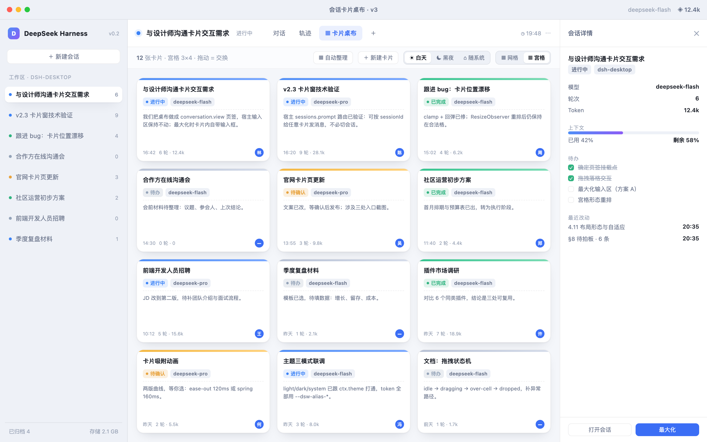
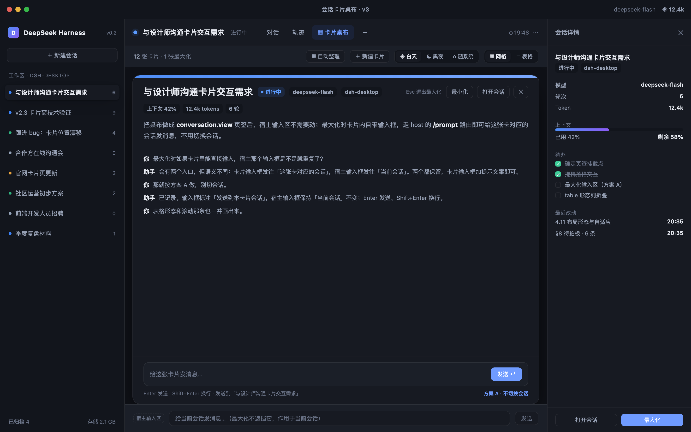

# dsh-session-cards

把 DeepSeek Harness 的会话做成**卡片桌布**：在会话详情画布上铺开一桌卡片，支持网格 / 宫格 / 自由三种布局，可拖动、拖边缘缩放、最小化、最大化，也能把任意一张卡片弹出成**原生独立窗口**。





---

## 功能

- **卡片桌布占满会话画布**：以「卡片桌布」页签加入会话视图（`conversation.view`），不替换会话根界面，输入区、会话头、侧栏都保留。
- **三种布局**
  - **网格**：自由网格，可拖到任意空位、落到已占格则交换；拖动时连续跟手、松手吸附格子。
  - **宫格**：九宫格（≤9 张）/ 十二宫格（10–12 张），等大铺满、不滚动。
  - **自由**：绝对定位，卡片可重叠；拖动移动、拖四边/四角缩放（左/上边缘会真正向外生长）。
- **卡片内容 = 真实会话记录**：标题、状态色点、最后几轮对话、工作区、时间；条数随卡片尺寸变化。
- **卡片内直接发消息**：悬停出现输入条（Enter 发送 / Shift+Enter 换行），走插件 host 路由调用宿主的 `sessionController.prompt`，**不切换当前会话**。
- **三态**：标准、最小化（底部 dock，点击还原）、最大化（铺满画布，Esc 还原）。
- **原生浮窗**：卡片右上角 `⧉` 弹出独立窗口；原生标题栏可拖动、可缩放、位置/尺寸记忆、拖回主窗自动收回、可选置顶、同会话去重、最多 8 个窗口。
- **主题跟随**：light / dark / system 跟随宿主；颜色使用 `--dsw-alias-*` 并提供兜底色。
- **可降级、抗升级**：只依赖公开契约；宿主缺少某个 slot/服务时按 L0→L4 逐级降级（页签 → 浮层 → 头部按钮 → 只读 → 不注册 UI），不会白屏。

## 安装

要求 **DSH 0.2.2+**（桌面端或 `dsh web` 均可），Node 20+。

### 桌面端（推荐）

在 DSH 的插件页安装，或：

```sh
dsh plugin --profile desktop add github:tom143tc/dsh-session-card
```

也可以指向本地目录（开发时）：

```sh
dsh plugin --profile desktop add file:/absolute/path/to/dsh-session-card
```

然后完全退出并重启 DSH NEXT。

### dsh web

```sh
dsh plugin --profile web add github:tom143tc/dsh-session-card
```

重启 `dsh web`，刷新页面。

### 原生浮窗的前置条件

浮窗由插件自建的 Electron 管家进程提供，**不依赖 desktop 的私有 API**。需要本机存在 Electron 可执行文件，按以下顺序查找：

1. 环境变量 `DSH_CARDS_ELECTRON` 指向的可执行文件
2. `~/.dsh/electron/Electron.app/Contents/MacOS/Electron`（macOS）
3. 同名目录下的 Windows / Linux 路径

找不到时只有「弹出浮窗」不可用（返回 `NO_ELECTRON`），桌布与卡片输入不受影响。

## 使用

1. 打开任意会话 → 点顶部「卡片桌布」页签。
2. 从左侧会话列表**拖入**，或点工具栏「＋ 当前会话」。
3. 工具栏：`自动排列` / `⟳ 刷新` / `▦ 网格` / `▦ 宫格` / `◱ 自由`。
4. 卡片右上角悬停出现：`—` 最小化、`⧉` 弹出浮窗、`⤢` 最大化、`✕` 从桌布移除。
5. 拖卡片边缘缩放；自由布局下左/上边缘会向外生长。
6. 悬停卡片底部出现输入条，可直接向该会话发消息。

## 数据与隐私

- 桌布布局保存在浏览器 `localStorage`（键 `dsh-session-cards/board/v1`，按宿主 origin 隔离）。
- 浮窗状态（窗口位置/尺寸/置顶/管家信息）在 `~/.dsh/dsh-session-cards/`（文件权限 0600）。
- 卡片内容通过插件 host 的只读接口 `/plugins/dsh-session-cards/transcript` 从会话日志读取（`sessionQuery.readSession`），**不修改会话记录**。
- 插件不发起任何外部网络请求；浮窗管家只监听 `127.0.0.1` 随机端口并使用一次性 token。

## 兼容与降级

| 能力 | 缺失时的行为 |
|---|---|
| `conversation.view` | 注册右侧浮层（L1），顶部提示「当前版本以浮层模式运行」 |
| 浮层 slot 也没有 | 在会话头部注册「卡片桌布」按钮（L2） |
| 会话服务不可用 | 只读模式（L3）：只显示标题/状态，禁止拖拽与写入 |
| 连头部按钮都注册失败 | 不注册 UI（L4），写诊断报告，设置页可见原因 |

不修改宿主 DOM 语义、不注入 preload、不使用 `desktopRuntime` 等私有服务；DOM 侧仅做「尽力而为」的增强（如侧栏拖入），失败时退回工具栏按钮。

## 已知限制

- 桌布最多 12 张卡片（按画布容量设计）。
- 卡片正文来自会话日志投影，工具调用行只在最大化时显示。
- 原生浮窗目前在 macOS 实测；Windows / Linux 未验证。
- 宿主升级若改动插件加载协议本身，插件无法自救，只能跟随适配。

## 开发

```sh
npm test                 # node --test test/
npm run build:client     # 把 src/lib + src/client 内联成单文件 client.js
```

目录：

```
index.js             # host 半侧：prompt / transcript / popout 路由
client.js            # 由 scripts/build-client.mjs 生成的浏览器半侧（已提交）
src/lib/             # 纯函数：布局、桌布模型、能力判定（含单测）
src/client/          # 客户端 UI：桌布、卡片、输入、降级注册
popout/main.cjs      # 自建 Electron 管家（窗口、位置记忆、拖回收回）
cordis.patch.yml     # 插件装载补丁
```

## English

Session cards for DeepSeek Harness. Adds a **Cards** tab to the conversation canvas where sessions become draggable cards with three layouts — grid, matrix (3×3 or 3×4), and freeform. Cards show the real conversation tail, can be resized from any edge, minimized, maximized (Esc to restore), and sent to a **native floating window** with position memory and drag-back-to-dock. Each card has an inline composer that posts to its own session without switching the current one.

- Requires DSH 0.2.2+, Node 20+.
- Install: `dsh plugin --profile <profile> add github:tom143tc/dsh-session-card`, then restart.
- Floating windows need an Electron binary (env `DSH_CARDS_ELECTRON`, or `~/.dsh/electron/...`); without it only pop-out is disabled.
- Degrades L0→L4 (tab → overlay → header button → read-only → no UI) instead of breaking.

## License

MIT
